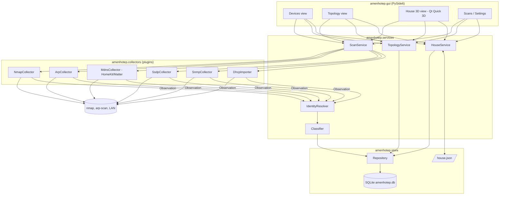
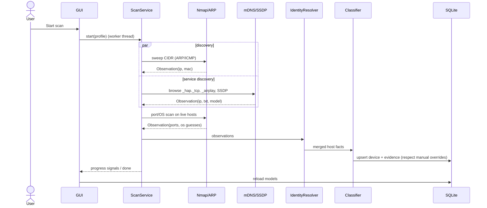
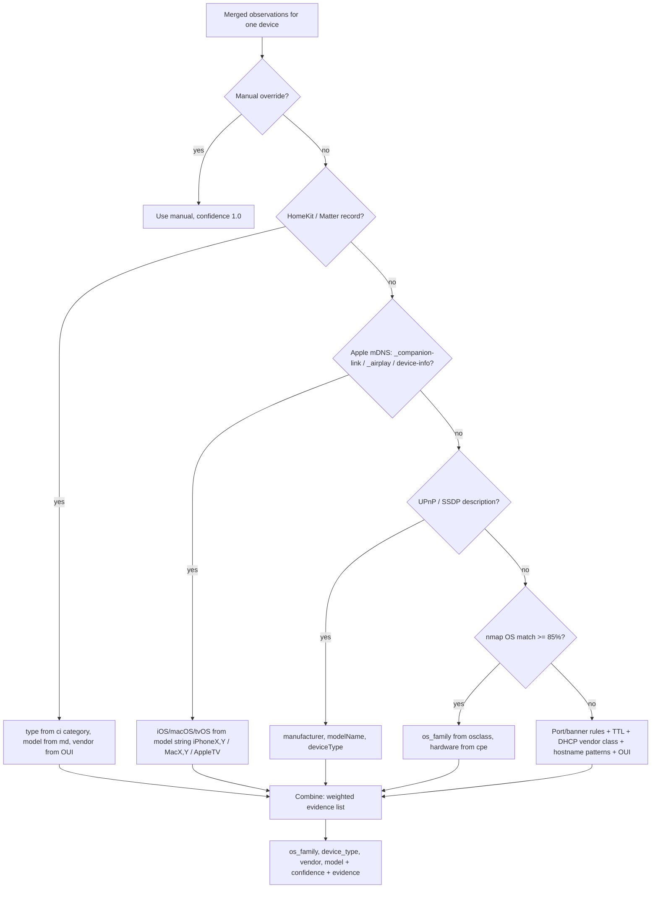
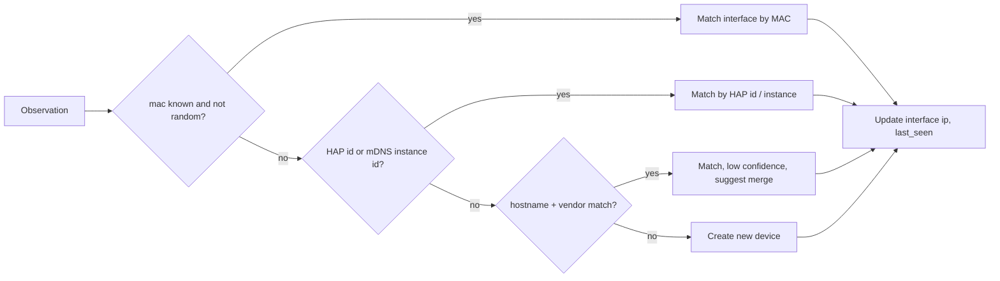
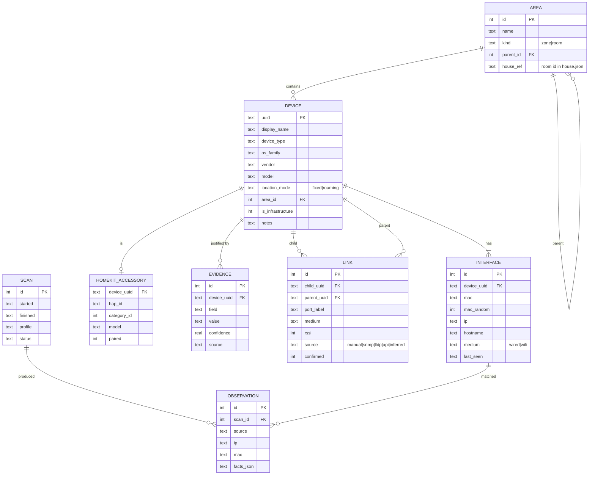
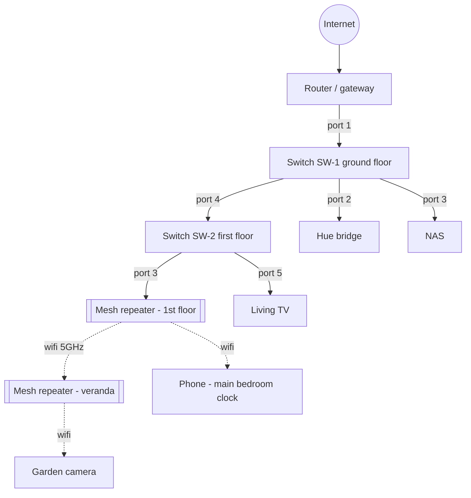
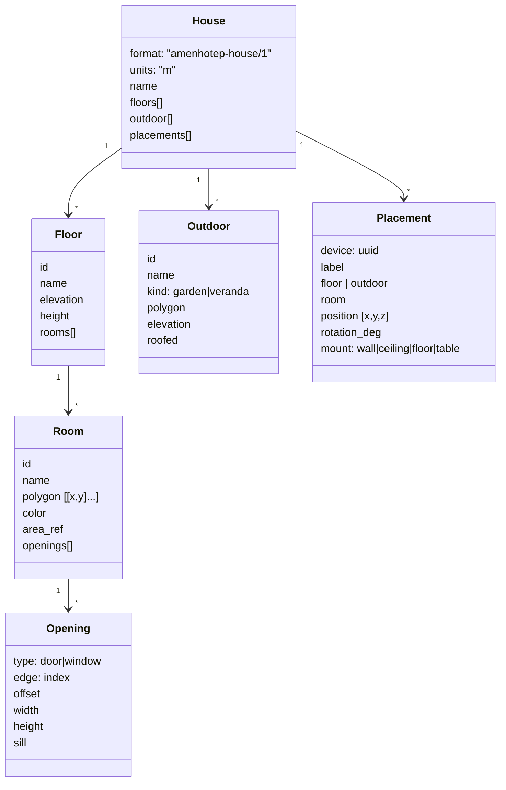
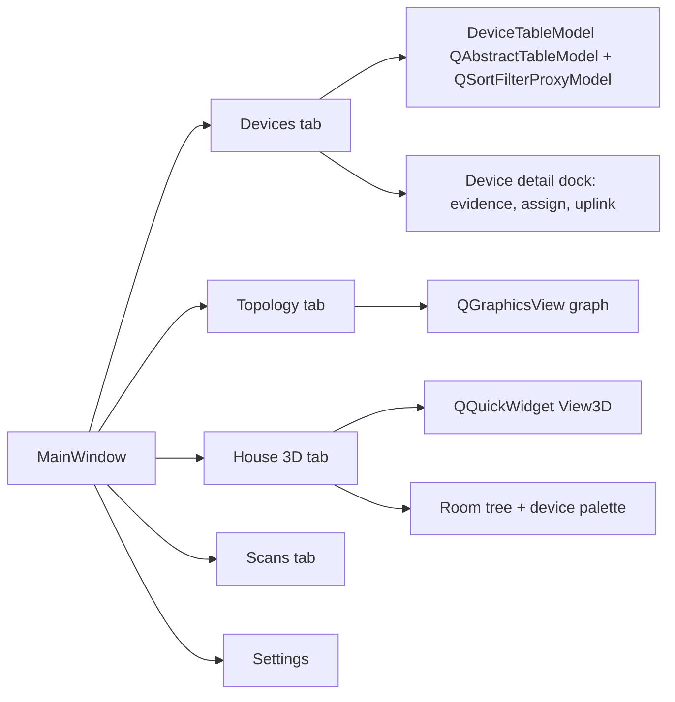
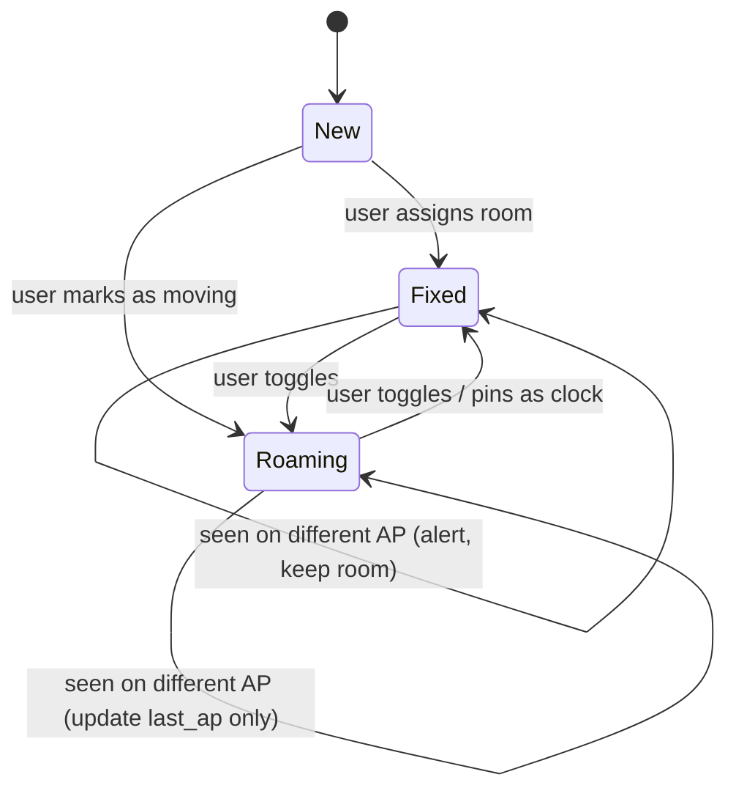

# Amenhotep — Design

## 1. Architecture

Layered, single process for the GUI, scanner work in worker threads/subprocesses. The backend is a plain Python package with no Qt imports, so it is usable from a CLI and testable headless.



### Packages

```
amenhotep/
  src/amenhotep/
    core/        models (pydantic), enums, settings
    collectors/  one module per source; common Collector protocol
    services/    scan, identity, classify, topology, house
    store/       sqlite repository, migrations, house file io
    data/        oui.csv, hap_categories.json, os_rules.yaml, schema/
    gui/         PySide6 widgets, models, QML for 3D
    cli.py       `amenhotep scan | list | export | validate-house`
  tests/
  model/         schema.sql, house.schema.json, house.example.json
```

## 2. Collector → Observation pipeline

Each collector emits immutable **Observations**: `{source, ts, ip?, mac?, hostname?, facts{...}, raw?}`. Collectors never write to the DB. The identity resolver merges observations into devices; the classifier derives type/OS/model from the merged facts.



Progress and cancellation travel via Qt signals from a `QThread` worker that wraps the backend's callback interface; the backend only knows a `ProgressSink` protocol.

## 3. Classification

Evidence is scored and combined; the highest-confidence value wins per field. Manual values = 1.0 and lock the field.



Rule weights (initial; tuned via tests with captured fixtures):

| Evidence | Weight | Examples |
|----------|-------:|----------|
| Manual | 1.00 | user edit |
| HAP TXT (`md`, `ci`) | 0.95 | `md=Hue Bridge`, `ci=2` |
| Apple device-info `model=` | 0.95 | `iPhone15,2`, `Mac14,2` |
| UPnP `modelName` | 0.85 | printers, TVs, routers |
| nmap OS accuracy ≥ 90 | 0.85 | `Linux 5.x`, `Microsoft Windows 11` |
| DHCP option 60 / hostname | 0.60 | `android-dhcp-13`, `MSFT 5.0` |
| Open-port signature | 0.50 | 445+3389 → Windows; 22+5000 → Synology |
| OUI vendor | 0.40 | Espressif → IoT; Apple → Apple |
| TTL | 0.20 | 64 → Unix-like, 128 → Windows, 255 → network gear |

Rules live in `data/os_rules.yaml` so the user can extend them without code changes.

OS families: `linux`, `windows`, `ios`, `ipados`, `macos`, `tvos`, `android`, `rtos/embedded`, `unknown`. iOS cannot be proven by nmap alone (it often returns "Apple iOS/macOS"); mDNS `model=` is the reliable discriminator.

Randomized MACs (bit 1 of first octet set) → flagged `mac_random=true`; identity falls back to mDNS instance / hostname.

## 4. Identity and merging



A device has 1..n **interfaces** (MAC, IP, medium). A laptop with a dock (wired) and Wi-Fi has two interfaces, one device.

## 5. Data model



Full DDL: [`model/schema.sql`](model/schema.sql). Migrations: `PRAGMA user_version` + ordered SQL scripts.

Rule: **manual wins**. Columns edited by the user are tracked in `device.locked_fields` (JSON list) and never overwritten by scans.

## 6. Topology

Infrastructure devices (router, switches, APs, mesh nodes) are devices with `is_infrastructure=1`. `LINK` rows form a forest rooted at the router.



Sources of uplink info, in priority: manual → SNMP FDB/LLDP → mesh/router API → inferred (suggestion only). Unmanaged switches are invisible to every protocol; the user draws the link manually, and the topology view lets them drag a device onto a switch to create it.

## 7. House model and 3D format

### 7.1 Why this format

| Option | Verdict |
|--------|---------|
| glTF/GLB as source | Great for viewing, poor for hand editing, no semantics (rooms, devices). Used as **export** only. |
| Blender .blend / FreeCAD | Heavy, not diff-friendly. |
| OpenSCAD / IFC | IFC is the right "standard" but verbose. Overkill. |
| **Custom JSON (`amenhotep-house/1`)** | Human-editable, JSON-Schema validated, diff-friendly in git, 2D polygons extruded to 3D, devices referenced by UUID. **Chosen.** |

### 7.2 Conventions
- Units: metres. Right-handed, **Z up** in the file; the renderer converts to Qt's Y-up.
- X to the east, Y to the north. Origin is the south-west corner of the ground floor.
- Each floor has `elevation` (z of its floor slab) and `height`.
- Rooms are 2D polygons (counter-clockwise, in floor-local metres) extruded by floor height. Walls are generated along the edges; `openings` cut doors/windows.
- Device `position` is `[x, y, z]` where z is height **above the floor slab** (so moving a floor keeps devices attached).
- `device` refers to `devices.uuid` in the DB; `label` is a fallback if the DB lacks the device.

### 7.3 Structure



A worked example is in [`model/house.example.json`](model/house.example.json) and the schema in [`model/house.schema.json`](model/house.schema.json).

### 7.4 Rendering

- Qt Quick 3D `View3D` embedded in a `QQuickWidget` (supported path in PySide6; Qt3D is in maintenance).
- Python builds a QML scene description from the validated model: `Model` with generated `QQuick3DGeometry` for each extruded room, semi-transparent walls, instanced markers for devices. `PickResult` drives selection and dragging (drag on the floor plane → x,y; modifier+drag → z).
- Unplaced devices are auto-laid on a grid in their room until the user places them. The grid position is not written to the file until the user confirms.
- Edits write back through `HouseService.save()` using atomic write (temp file + rename) and keep a `house.json.bak`.

### 7.5 Assigning rooms ↔ areas

Room `id` in `house.json` ↔ `area.house_ref` in DB. Renaming a room in either place keeps the id stable. A device's `area_id` decides which room it belongs to; its placement decides where inside the room.

## 8. GUI structure



- Models/views (`QAbstractTableModel`) so large lists stay fast.
- Backend calls from the UI go through a `QThreadPool` runner; results return by signal.
- Theme follows the system palette; colour is never the only status indicator (icons + text).

## 9. Location mode (roaming vs fixed)



## 10. Key decisions

| ID | Decision | Rationale |
|----|----------|-----------|
| D1 | PySide6 over PyQt6 | LGPL, official Qt for Python, Quick 3D included. |
| D2 | SQLite via stdlib | "Basic format" DB, single file, transactional, no server. |
| D3 | nmap as subprocess with XML output | Stable interface, no root in the Python process. |
| D4 | zeroconf for mDNS in-process | HomeKit info only available via mDNS; pure Python. |
| D5 | Custom JSON house format + glTF export | Editable and semantic; interoperable on export. |
| D6 | Collectors as plugins emitting Observations | Easy to add sources and to test with fixtures. |
| D7 | Manual edits always win | Prevents scans from undoing user knowledge. |

## M5 addendum: Matter and Thread

Migration `002_matter_thread.sql` adds `matter_node` (one row per `_matter._tcp` instance `<fabric>-<node>`, addresses as JSON, optional `host_uuid` when an address also belongs to a LAN host, user `label`/`area_id`) and `thread_border_router` (from `_meshcop._udp`: `nn`, `vn`, `mn`). Thread devices have no IPv4 address, so they are *not* hosts; they are stored separately and shown as "Thread (probably)" when IPv6-only and not matched to a host. A device commissioned into several ecosystems announces one instance per fabric at the same address; `services/matter.group_matter_nodes` merges these into one device. Matter announcements carry no vendor or model, so identification stays manual (label) or via the controller's own app.

## Presence addendum

Migration `003_presence.sql` adds `sighting(device_uuid, scan_id, ts)` (one row per device per finished scan that saw it) and `device.last_probed` (last full fingerprint). `ScanService.watch` runs: quick sweep → neighbour table → mDNS → unicast mDNS reverse → resolve + sightings → targeted `standard` fingerprint of `devices_needing_probe` (never probed, or unidentified and older than 6 h; max 8). Presence statistics (`services/presence.py`) divide a device's sightings by the checks that logged sightings, per local hour; an hour counts as "typically online" with at least 3 checks and a seen ratio of 50 % or more. `prune(90)` deletes older scans (cascading to observations and sightings) but always keeps the latest finished scan.

## M5 addendum: HomeMapper CSV import

`amenhotep import-homemapper FILE` (or Scans tab → *Import HomeMapper CSV…*) merges an export of
the HomeMapper iPhone app. Rows match a device by serial, MAC, IPv4, name, then a unique model;
a row whose IPv6 address equals a Matter node's enriches that node (label, room, Thread details).
Fields without a column (firmware, battery, signal, Thread role/channel/stability, last online…)
go into a marked `[HomeMapper import: <file>]` block of the Notes of the device, Matter node or
border router; re-importing replaces the block. Identity from the Home app is evidence
(source `homemapper`, 0.9); user locks win, names and areas already set are kept, and a row that
contradicts the stored vendor *and* model only adds a warning note. Each import is recorded in
`import_log` (migration 004) and listed on the Scans tab. Unknown Home rooms are added as areas
without a floor.
